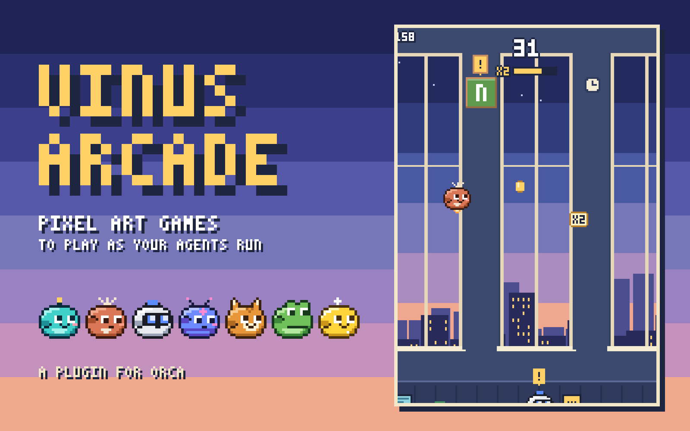
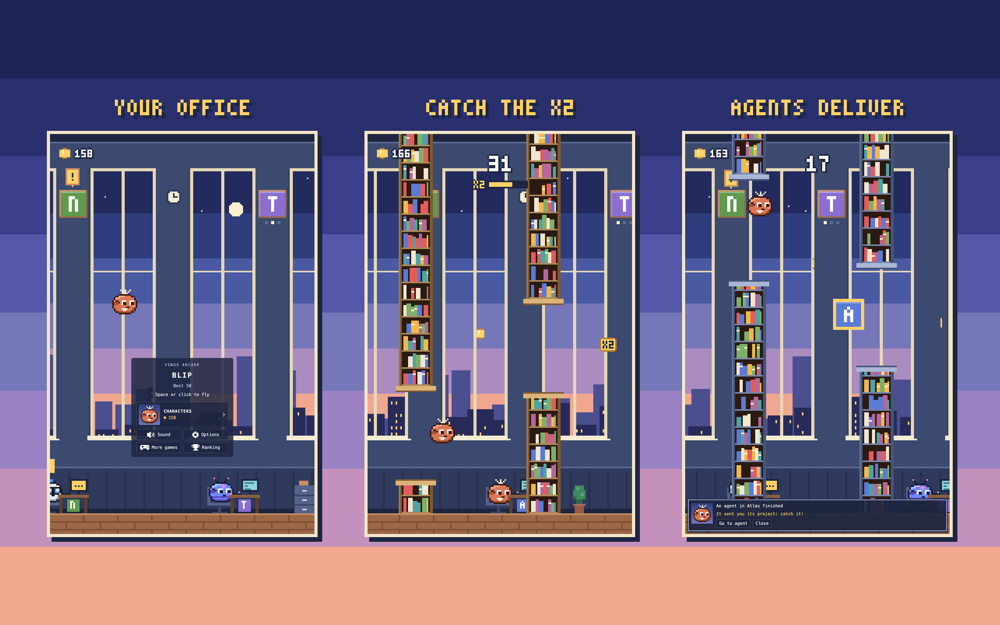
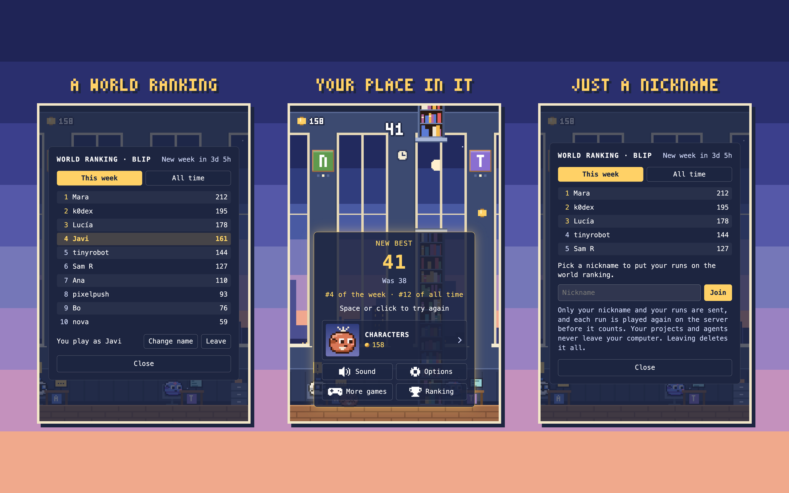

# Vinus Arcade



Juegos en pixel art para [Orca](https://github.com/stablyai/orca), para la espera entre agentes.
Se juegan en una oficina que es tuya: tus proyectos cuelgan de su pared, tus agentes se sientan en
sus escritorios y te mandan lo que terminan mientras juegas y, cuando uno te necesita, el juego
te lo dice y un clic te lleva a él. Un ranking mundial guarda las mejores partidas de la semana
y de siempre, para quien quiera estar en él.

Es un solo panel con varios juegos adentro, no un panel por juego. El primero es **Blip** y
vienen más en camino: **Más juegos**, en la tarjeta, muestra los que hay y el lugar guardado para
los siguientes. Las monedas, los personajes y los ajustes son de todos, y cada juego guarda su
propio récord.

Habla inglés y español: inglés hasta que elijas español en las opciones (**Options → Language**).

Hecho por [Javier Vinueza](https://github.com/Javiervinus) · [Read in English](README.md)

## Instalar

Desde una terminal:

```sh
orca plugin install Javiervinus/vinus-arcade-orca
```

Orca muestra lo que el plugin pide antes de que corra (mira [Permisos](#permisos)). El juego
queda en la barra lateral derecha, bajo el cohete. Su página en el directorio de plugins de Orca
es [onorca.dev/plugins/Javiervinus/vinus-arcade-orca](https://www.onorca.dev/plugins/Javiervinus/vinus-arcade-orca).



## Blip

Lleva a un pequeño agente entre las estanterías de una oficina al anochecer.

- **Espacio**, **↑**, **W**, **Enter** o un clic: volar, empezar, reintentar.
- **P** o **Esc**: pausa. **M**: sonido sí o no.
- Cada estantería es un punto y cada moneda, uno más. Las monedas aparecen en algunos huecos y en
  otros no, así que nunca sabes dónde estará la siguiente. El juego acelera y los huecos se
  estrechan hasta un límite.
- Cada tanto, en lugar de una moneda pasa una ficha dorada **x2**: atrápala y las monedas que
  atrapes cuentan el doble por 12 segundos. Nunca sale en las primeras estanterías de una partida
  ni poco después de la anterior. Una barra bajo el puntaje muestra cuánto le queda, y se acaba
  con la partida.
- El juego se pausa solo cuando haces clic fuera, así que escribir en una terminal nunca te cuesta
  una partida.
- Al pasar tu récord en plena partida, el puntaje se vuelve dorado; si la partida termina como
  récord, hay confeti.

## Tus agentes

- **Escritorios**: cada agente que tienes corriendo en Orca se sienta en un escritorio de la
  oficina, con el color del agente que es. Teclea mientras trabaja, levanta un cartel `!` cuando te
  espera, suda frente a una pantalla roja cuando está bloqueado y duerme una hora después de
  terminar. El frente de su escritorio lleva el ícono de su proyecto.
- **Placas**: tus proyectos cuelgan de la pared, cada uno con su ícono: el que le pusiste en Orca;
  si no, el que hay en su carpeta; si no, su inicial sobre un color propio. Debajo de una placa se
  encienden tres puntos mientras un agente trabaja ahí, y encima cuelga un cartel `!` cuando uno
  te espera. Con pocos agentes, la pared se llena con los proyectos en los que trabajaste último.
- **Monedas**: se ganan jugando, y solo jugando. Una moneda que atrapas vale 1; cada
  juego puede tener su manera de hacer que cuenten más, que se encuentra jugando, como la ficha
  x2 de Blip.
- **Entregas**: cuando un agente termina una tarea te lo dice y, si estás en plena partida, manda
  su proyecto al campo de juego: atrápalo y son 5 monedas. Un turno que interrumpiste no cuenta
  como tarea terminada.
- **Avisos**: el agente te habla desde el pie de la sala, con su cara. Si te espera o está
  bloqueado, **Ir al agente** muestra su workspace en Orca. A un agente de la ventana flotante de
  Orca no se puede ir, porque no es un workspace: el aviso dice que está ahí.
- **Mientras no mirabas**: al volver al panel, el juego te dice cuántas tareas terminaron tus
  agentes mientras tanto y en qué proyectos.
- **Personajes**: con las monedas se compran personajes nuevos y cosas que ponerles. **Auto** toma
  el color del agente que corre en el workspace que tienes enfocado.

## Ranking mundial

**Ranking**, en la tarjeta, muestra las diez mejores partidas de cada juego de esta semana (de
lunes a domingo, en UTC) y de siempre. Para estar en él, elige ahí un apodo; desde entonces se
envía cada partida que supere tu mejor puntaje de la semana, y la tarjeta te dice tu puesto al
terminar. Puedes cambiar el apodo o salir: al salir se borran del servidor tu apodo y todos tus
puntajes.



Un puntaje no se puede inventar. Cada partida se graba como su semilla y los momentos en que
pulsaste, y el servidor la vuelve a jugar con las mismas reglas antes de contarla; si no da el
mismo puntaje, no cuenta. Un bot que vuele bien podría jugar, pero tendría que volar.

## Opciones

| Opción | Qué hace | De fábrica |
| --- | --- | --- |
| Idioma (Language) | El idioma del panel: English o Español. | English |
| Sonido | Los sonidos del juego y la campanita de los avisos. | Sí |
| Nombres de proyectos | En «no» se ocultan los íconos y los nombres de tus proyectos, para cuando compartes pantalla. | Sí |
| Pausar cuando un agente te necesita | El juego se detiene cuando un agente espera tu respuesta o se bloquea. | Sí |
| Pausar cuando un agente termina | El juego se detiene cuando un agente termina una tarea. | No |

## Privacidad y permisos

En corto: **tus proyectos, tus agentes y tus archivos nunca salen de tu computadora.** El plugin
solo usa la red si entras al ranking mundial, y entonces envía solo tu apodo y el registro de tus
partidas (cuándo pulsaste, no lo que tienes abierto).

Orca advierte que un plugin como este tiene acceso completo, porque su worker corre como un
programa normal. Esa advertencia es de Orca y sale igual en todo plugin con worker; esto es lo
que hace este con ella, y todo el código está aquí para revisarlo.

Necesita la app de escritorio de Orca, 1.4.248 o más nueva.

| Pide | Para qué |
| --- | --- |
| `trusted-worker` | Un worker escucha a tus agentes con el panel cerrado, para contarte al volver lo que terminaron, y solo un worker puede cambiar lo que Orca muestra o leer el ícono de un proyecto. Lo que hace está listado abajo, y está todo en `src/worker.ts`. |
| `agent:read` | Para enterarse de que un agente empieza a trabajar, espera, se bloquea o termina. |
| `workspace:read` | Para leer el nombre y la carpeta del proyecto de tus workspaces, para las placas y los avisos. |
| `workspace:write` | Para mostrar el workspace del agente al que decidiste ir. |
| `storage:own` | Para guardar tus récords, tus monedas, tus personajes, tus ajustes, lo que se sabe de tus agentes y, si entraste al ranking, tu apodo y el secreto que le dice al servidor que tus partidas son tuyas. |

Un worker de confianza corre con el acceso de tu usuario, así que esto es todo lo que hace fuera
del API de plugins de Orca:

- Corre el CLI `orca` que viene dentro de la app, `orca worktree ps` y `orca repo list`, para
  conocer a todos los agentes de todos los workspaces (el API de plugins solo lista el workspace
  enfocado) y el ícono que le pusiste a cada proyecto. De cada agente guarda dónde corre, qué
  agente es y su estado; descarta su prompt y sus mensajes (`src/agents/cli.ts`).
- En las carpetas de los proyectos que Orca lista, y en ninguna otra, busca un archivo de ícono
  (`favicon`, `icon`, `logo`...) y lee cuándo se trabajó ahí por última vez (`src/agents/disk.ts`).

- Si entraste al ranking mundial, y solo entonces, habla con su servidor
  (`vinus-arcade.javiervinueza.workers.dev`, su código está en `server/`): tu apodo, el registro
  de cada partida que supera tu mejor puntaje de la semana y un secreto al azar, creado en tu
  computadora, que le dice al servidor que tus partidas son tuyas. El servidor guarda el apodo y
  tu mejor puntaje de cada semana y de siempre, y nada más: ni tu IP, ni proyectos, ni agentes.
  Al salir del ranking se borra todo (`src/ranking/client.ts`).

No recoge nada más: los nombres y los íconos de tus proyectos no salen de Orca.

## Desarrollo

```sh
orca plugin dev watch . --check   # carga esta carpeta en Orca y recarga al guardar
orca plugin test .                # las reglas de cada juego, los agentes y el worker
npx -p typescript tsc -p .        # tipos; el transpilador de Orca no los revisa
```

No hay paso de compilación: Orca carga el TypeScript de `src/` tal cual.

| Dónde | Qué tiene |
| --- | --- |
| `src/main.ts`, `src/panel.html` | El panel, que es lo que comparten todos los juegos: la entrada, el bucle de cuadros y la pausa, la tarjeta entre partidas, las monedas, el récord de cada juego, los ajustes y los avisos. |
| `src/core/` | Las piezas compartidas. `game.ts` es el contrato que cumple cada juego; el resto son la oficina con sus placas y escritorios, los personajes y la tienda, los ajustes, los avisos, los sonidos y los textos. |
| `src/games/` | Un juego por carpeta, con sus reglas, su dibujo y sus sonidos. `index.ts` es la lista de juegos. |
| `src/games/blip/` | Blip: `engine.ts` son las reglas, sin DOM ni reloj (la misma semilla da siempre la misma partida); `replay.ts`, el registro de una partida y cómo volver a jugarla; `render.ts`, todo lo que se dibuja; `game.ts`, Blip tal como lo juega el panel. |
| `src/agents/` | Lo que el worker sabe de tus agentes y tus proyectos: el libro (`ledger.ts`, puro), el CLI de la app (`cli.ts`) y los íconos (`disk.ts`). |
| `src/worker.ts`, `src/protocol.ts` | El worker y el contrato entre el worker y el panel. |
| `src/ranking/` | El ranking mundial: el contrato con su servidor (`api.ts`) y la parte del worker (`client.ts`). |
| `server/` | El servidor del ranking, un Cloudflare Worker con una base D1. Vuelve a jugar cada partida con el mismo código con que la juega el panel (`src/games/<id>/replay.ts`). Mira [server/README.md](server/README.md). |
| `media/` | Las imágenes de la página del plugin: ícono, portada y capturas. El juego no trae imágenes; todo lo que dibuja es código. |

### Agregar un juego

1. Crea `src/games/<id>/` con sus reglas y su dibujo.
2. Exporta de su `game.ts` un `GameDefinition` (`src/core/game.ts`): su `id`, su nombre, sus
   textos en inglés y español y `create(host)`, que devuelve la partida. El `host` le da la
   oficina para dibujarla en su mundo, el personaje en uso, los sonidos, y cómo avisar de una
   moneda o de una entrega atrapada; de pagarlas, del récord y de la pausa se ocupa el panel.
3. Agrégalo a `src/games/index.ts`.
4. Para el ranking, su partida devuelve un `proof()` al terminar: lo que el servidor necesita para
   volver a jugarla. Agrega el juego a `GAMES` en `server/src/index.ts` y despliega el servidor.

El `id` de un juego nombra su récord guardado: no se cambia después de publicarlo.

## Sin afiliación

Es un plugin independiente. Sus personajes son dibujos originales; los nombres de agentes que
llevan solo dicen el color de qué agente recuerda cada uno. No lo hace ni lo avala Anthropic,
OpenAI, Google ni Stably.

[Licencia MIT](LICENSE). Los cambios de cada versión están en el [registro de cambios](CHANGELOG.md).
