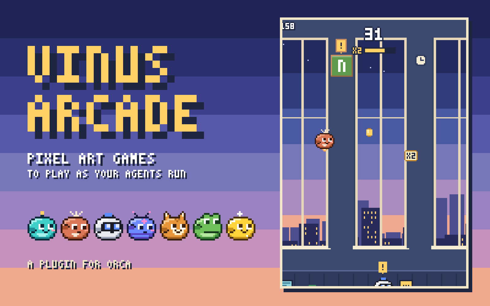
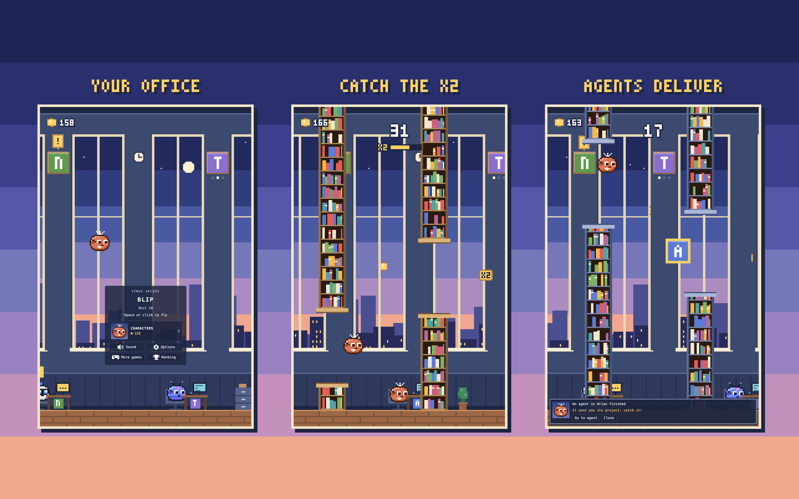

# Vinus Arcade



Pixel art games for [Orca](https://github.com/stablyai/orca), for the wait between agents. They
are played in an office that is yours: your projects hang on its wall, your agents sit at its
desks and send you what they finish while you play, and when one of them needs you the game
tells you and one click takes you to it.

It is one panel with several games inside, not a panel for each game. The first one is **Blip**,
and more are on the way: **More games**, on the card, shows the ones there are and the room kept
for the next. The coins, the characters and the settings belong to all of them, and each game
keeps its own best score.

It speaks English and Spanish: English until you choose Spanish in the options.

Made by [Javier Vinueza](https://github.com/Javiervinus) · [Leer en español](README.es.md)

## Install

From a terminal:

```sh
orca plugin install Javiervinus/vinus-arcade-orca
```

Orca shows what the plugin asks for before it runs (see [Access](#access)). The game then lives
in the right sidebar, under the rocket. Its page in Orca's plugin directory is
[onorca.dev/plugins/Javiervinus/vinus-arcade-orca](https://www.onorca.dev/plugins/Javiervinus/vinus-arcade-orca).



## Blip

Fly a little agent between the bookshelves of an office at dusk.

- **Space**, **↑**, **W**, **Enter** or a click: fly, start, try again.
- **P** or **Esc**: pause. **M**: sound on or off.
- Each bookshelf is a point and each coin one more. The game speeds up and the gaps narrow, up to
  a limit.
- Now and then a gold **x2** tile flies by instead of a coin: catch it and the coins you catch
  count double for 12 seconds. A bar under the score shows the time left, and it ends with the
  run.
- The game pauses by itself when you click away, so typing in a terminal never costs you a run.
- When you pass your best score in the middle of a run, the score turns gold; a run that ends as
  the new best gets confetti.

## Your agents

- **Desks**: every agent you have running in Orca sits at a desk on the office floor, in the
  colour of the agent it is. It types while it works, puts a `!` sign up when it waits for you,
  sweats in front of a red screen when it is blocked, and sleeps for an hour after it finishes.
  The front of its desk carries its project's icon.
- **Plaques**: your projects hang on the wall, each with its own icon: the one you gave it in
  Orca, else the one found in its folder, else its initial on its own colour. Three dots light up
  under a plaque while an agent works there, and a `!` sign hangs over it when one waits for you.
  With few agents, the wall fills with the projects you last worked in.
- **Coins**: you earn them playing, and only playing. A coin you catch is worth 1; a game
  may have its own way to make them count more, found while playing, like the x2 tile of Blip.
- **Deliveries**: when an agent finishes a task it tells you, and if you are in the middle of a
  run it sends its project in: catch it for 5 coins. A turn you interrupted is not a finished
  task.
- **Notices**: the agent speaks to you from the foot of the room, with its face. If it waits for
  you or is blocked, **Go to agent** shows its workspace in Orca. An agent in Orca's floating
  window cannot be gone to, because it is not a workspace: the notice says it is there.
- **While you were away**: when you come back to the panel, the game tells you how many tasks
  your agents finished meanwhile and in which projects.
- **Characters**: coins buy new characters and things to wear. **Auto** takes the colour of the
  agent running in the workspace in focus.

## Options

| Option | What it does | Default |
| --- | --- | --- |
| Language (Idioma) | The language of the panel: English or Español. | English |
| Sound | The game's sounds and the chime of the notices. | On |
| Project names | Off hides the icons and the names of your projects, for when you share your screen. | On |
| Pause when an agent needs you | The game stops when an agent waits for your answer or gets blocked. | On |
| Pause when an agent finishes | The game stops when an agent finishes a task. | Off |

## Access

It needs the Orca desktop app, 1.4.248 or newer.

| It asks for | Why |
| --- | --- |
| `trusted-worker` | A worker hears your agents while the panel is closed, to tell you what they finished when you come back, and only a worker can change what Orca shows or read a project's icon. What it does is listed below, and is all in `src/worker.ts`. |
| `agent:read` | To hear when an agent starts working, waits, gets blocked or finishes. |
| `workspace:read` | To read the names and folders of your workspaces' projects, for the plaques and the notices. |
| `workspace:write` | To show the workspace of the agent you chose to go to. |
| `storage:own` | To keep your best scores, your coins, your characters, your settings and what is known of your agents. |

A trusted worker runs with your user account's access, so here is everything it does outside
Orca's plugin API:

- It runs the `orca` CLI that comes inside the app, `orca worktree ps` and `orca repo list`, to
  know every agent of every workspace (the plugin API lists only the workspace in focus) and the
  icon you gave each project. Of each agent it keeps where it runs, which agent it is and its
  state; it drops its prompt and its messages (`src/agents/cli.ts`).
- In the folders of the projects Orca lists, and nowhere else, it looks for an icon file
  (`favicon`, `icon`, `logo`...) and reads when the folder was last worked in
  (`src/agents/disk.ts`).

It makes no network requests and collects nothing: the names and icons of your projects stay in
Orca.

## Develop

```sh
orca plugin dev watch . --check   # loads this folder into Orca and reloads on save
orca plugin test .                # the rules of each game, the agents and the worker
npx -p typescript tsc -p .        # types; Orca's transpiler does not check them
```

There is no build step: Orca loads the TypeScript in `src/` as written.

| Where | What it holds |
| --- | --- |
| `src/main.ts`, `src/panel.html` | The panel, which is what every game shares: the input, the frame loop and the pause, the card between runs, the coins, each game's best score, the settings and the notices. |
| `src/core/` | The shared parts. `game.ts` is the contract every game implements; the rest is the office with its plaques and desks, the characters and the shop, the settings, the notices, the sounds and the texts. |
| `src/games/` | One game in each folder, with its rules, its drawing and its sounds. `index.ts` is the list of games. |
| `src/games/blip/` | Blip: `engine.ts` is the rules, with no DOM and no clock (the same seed always gives the same run); `render.ts`, everything that is drawn; `game.ts`, Blip as the panel plays it. |
| `src/agents/` | What the worker knows about your agents and your projects: the ledger (`ledger.ts`, pure), the app's CLI (`cli.ts`) and the icons (`disk.ts`). |
| `src/worker.ts`, `src/protocol.ts` | The worker, and the contract between the worker and the panel. |
| `media/` | The images of the plugin's page: icon, cover and screenshots. The game itself ships no images; everything it draws is code. |

### Adding a game

1. Create `src/games/<id>/` with its rules and its drawing.
2. Export a `GameDefinition` (`src/core/game.ts`) from its `game.ts`: its `id`, its name, its
   texts in English and Spanish, and `create(host)`, which returns the run. The `host` gives it
   the office to draw in its world, the character in use, the sounds, and how to report a coin or
   a delivery caught; paying them, the best score and the pause are the panel's job.
3. Add it to `src/games/index.ts`.

A game's `id` names its saved best score: it does not change once published.

## No affiliation

It is an independent plugin. Its characters are original drawings; the agent names they carry
only say which agent's colour each one recalls. It is not made or endorsed by Anthropic, OpenAI,
Google or Stably.

[MIT license](LICENSE). Changes by version in the [changelog](CHANGELOG.md).
